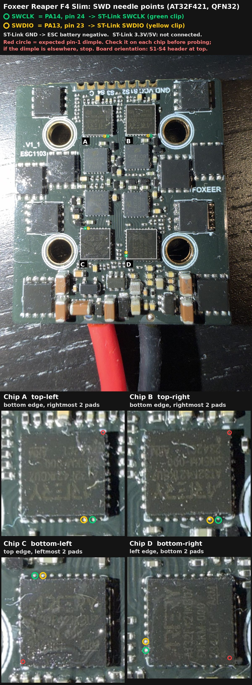
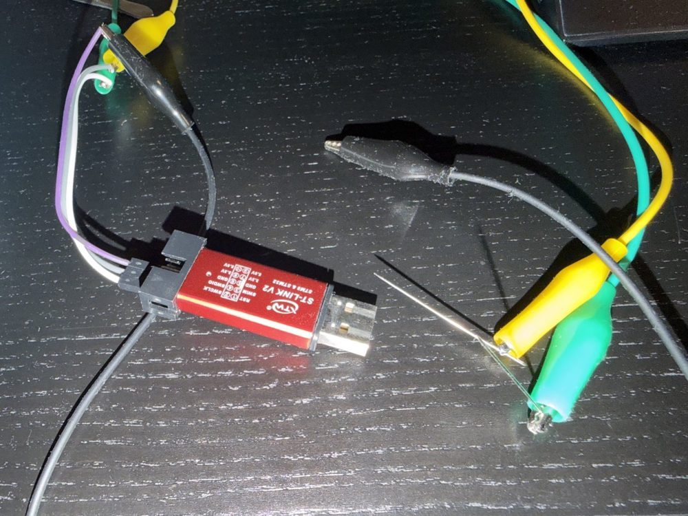

# Flashing Foxeer Reaper F4 Slim Mini 60A

The Foxeer Reaper F4 Slim Mini 128K 60A 4-in-1 (BLHeli_32 version, board marking `ESC1103 V1_1`) ships with BLHeli_32 32.9. It can be converted to AM32 with the [AM32 Unlocker](https://github.com/am32-firmware/AM32-unlocker). The procedure has been done on 6 boards.

| | |
| --- | --- |
| MCUs | 4x Artery AT32F421K8U7 (QFN32) |
| Bootloader | F421, signal pin **PA2** |
| AM32 target | **FOXEER_F421** |

## SWD connection

This board has **no SWD test pads**, so you probe the MCU pins directly:

| ST-Link | ESC |
| --- | --- |
| GND | ESC battery negative |
| SWCLK | MCU pin 24 (PA14) |
| SWDIO | MCU pin 23 (PA13) |
| 3.3V / 5V | not connected |

Power the ESC from its battery pads.

On Artery parts, pin 1 (the round dimple) is at the bottom-left when the marking is readable. So pins 24 and 23 are the two leftmost pads on the top edge. With the `T C S4 S3 S2 S1 VCC GND` header at the top of the board:

| Chip | Edge | SWCLK | SWDIO |
| --- | --- | --- | --- |
| top-left | bottom edge | rightmost pad | 2nd from right |
| top-right | bottom edge | rightmost pad | 2nd from right |
| bottom-left | top edge | leftmost pad | 2nd from left |
| bottom-right | left edge | bottom pad | 2nd from bottom |

A simple probe setup works: clamp two sewing needles in alligator clips on the ST-Link SWCLK and SWDIO leads, and hold them together on the two pads.

## Unlocking

For each of the 4 MCUs, in turn:

1. In the AM32 Unlocker, select Probe **ST Link**, MCU **F421**, Signal pin **PA2**, Mode **Unlock** (default bootloader `AM32_F421_BOOTLOADER_PA2_V17.bin`).
2. Click Start, power the ESC, and hold the needles on pins 24 and 23 until it reports Success.

If you get `init mode failed (unable to connect to the target)`, swap SWCLK and SWDIO. On Windows, a `LIBUSB_ERROR_NOT_SUPPORTED` error means the ST-Link needs the WinUSB driver (use Zadig).

## Flashing AM32

Reconnect the ESC to the flight controller and open the [AM32 Configurator](https://am32.ca) with Betaflight passthrough. Click Connect, then Read, then flash **FOXEER_F421** to all 4 ESCs.

A full walkthrough with the tools bundled is at [benedekvajas/foxeer-reaper-f4-slim-am32](https://github.com/benedekvajas/foxeer-reaper-f4-slim-am32).
